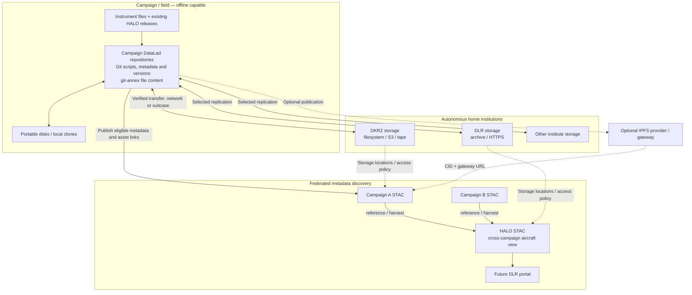

# Campaign Data Management Demo — Design

**Status:** Initial design for discussion and experimentation  
**Repository:** [campaign-data-demo](https://github.com/cehbrecht/campaign-data-demo)

## 1. Purpose

Demonstrate a practical, **offline-first** approach to managing scientific campaign data across independent research institutions. The demo addresses collecting, organizing, preserving, discovering and retrieving data—not running scientific analysis services or replacing the HALO-DB proposal.

The central question is:

> Can campaign participants exchange and preserve data across disconnected field environments and autonomous institutions, while making those data discoverable and retrievable through common standards, without depending on IPFS?

Use existing, maintained, community-supported tools and standards. IPFS remains a supported **optional publication and retrieval mechanism**, never a requirement for the core workflow.

## 2. Real-world context

Campaigns such as ORCESTRA involve multiple institutions, aircraft, ships and instruments; heterogeneous NetCDF, Zarr, CSV, image and instrument files; intermittent or absent connectivity; and portable disks physically exchanged between participants. Scripts are often campaign-specific and should be preserved alongside the data and their versions.

At home, institutions such as DKRZ and DLR independently operate storage systems, including file systems, S3-compatible object storage and tape archives. They decide how to package, preserve and serve their holdings. DLR's HALO archive provides a cross-campaign view of aircraft data; individual campaigns also need their own catalogs.

The ORCESTRA code review found separate tools for scientific preparation, HALO-DB download, IPFS import and pinning. These are not a complete automated lifecycle. HALO-DB access is not equivalent to permission to republish its files.

## 3. Principles and boundaries

1. **Offline first.** No central service or continuous connectivity is required to organize, version or exchange a campaign dataset.
2. **Autonomous partners.** Each campaign and institute controls its repositories, storage, access rules and publication decisions.
3. **Separate identity, location and access.** Dataset IDs, versions, file hashes, storage URLs and access permissions have different meanings.
4. **Preserve original content.** Storage packaging must be documented and recoverable; verify original bytes and metadata after retrieval.
5. **Format agnostic.** Support NetCDF, Zarr and arbitrary files. Data management does not prescribe how institutions expose data for analysis.
6. **Federated discovery.** Campaign catalogs and a HALO cross-campaign catalog can describe or reference the same datasets without centralizing their bytes.
7. **Optional integrations.** IPFS, Handle/DOI and pygeoapi add capabilities but cannot become mandatory dependencies.
8. **Minimal custom software.** Start with CLI tools, Git, manifests and static catalogs. Extract reusable helpers only after repeated needs emerge.

## 4. Component responsibilities

| Component | Role | Required for core demo? |
| --- | --- | --- |
| DataLad / Git | Versioned campaign datasets, scripts, metadata and subdataset relationships | Yes |
| git-annex | Content integrity, locations, offline copies and transfers | Yes |
| Local disks / file systems | Field exchange and initial institutional storage | Yes |
| STAC / PySTAC | Discovery metadata, catalog links and accessible assets | Yes |
| S3-compatible storage (e.g. MinIO) | Optional institutional storage backend | Later milestone |
| IPFS / Kubo / gateway | Optional publication protocol, CID and HTTP retrieval location | Optional experiment |
| pygeoapi | Optional processes, status and content-resolution endpoints | Not initially |
| Handle / DOI | Optional registered identifiers for scientific objects | Not initially |
| DLR portal | Future user-facing entry point across HALO datasets | Out of scope |

A git-annex key identifies managed content; a SHA-256 digest can verify exact file bytes. An IPFS CID may identify an encoded DAG rather than the raw file hash. DOI/Handle identify managed scholarly objects, not necessarily immutable file bytes. Do not conflate these identifiers.

## 5. Architecture

Catalogs are independent; the HALO catalog may link to campaign records or harvest selected metadata into a searchable index. Cross-catalog harvesting and identifier crosswalks require explicit design; STAC does not automatically synchronize catalogs.

## 6. Dataset organization and metadata

Allow multiple independent DataLad repositories and optional subdatasets. A campaign can keep one top-level repository and separate instrument/product repositories. Version small scripts, configurations, environment descriptions and scientific metadata with Git; annex large files. Do not force every institute to use DataLad internally merely to participate in STAC discovery.

A minimal STAC profile should identify campaign, platform, instrument, dataset, version/release, producer, temporal/spatial coverage when known, license/access conditions, source/provenance and assets. Use stable, namespaced identities across catalogs; local STAC Item IDs alone are not globally unique.

Preserve external HALO-DB mission, dataset and release identifiers when importing originals. Derived Zarr products receive distinct identities and provenance links to their inputs. Public metadata may exist without a public data URL; provide a contact point and access policy. **Authenticated download never implies redistribution permission.**

## 7. Storage and formats

Treat NetCDF, Zarr, logs, images and other files as valid scientific content. Zarr may contain very many small chunks, which can burden Git/annex inventories, object stores and tape systems. For the initial experiment, **package a Zarr store as a deterministic tar archive** for transport and archival storage, and verify that it can be unpacked and opened with xarray. This is a demo strategy, not a universal storage mandate.

Institutes may also publish native Zarr for efficient analysis. Such a representation has its own integrity metadata and access URLs. The campaign management layer need not provide partial reads or scientific subsetting. Storage operators can choose packing and object-size policies appropriate to MinIO and tape; no universal minimum object size is assumed.

## 8. Optional IPFS integration

When a partner already operates IPFS, they may publish selected content and provide a CID and an HTTP gateway URL. Record the native CID in catalog metadata and, where the URL returns the **exact annex-managed bytes**, register the gateway URL against the existing git-annex key using `git annex registerurl` after verification. A CID is not automatically interchangeable with a SHA-256 annex key.

IPFS availability, pinning, CAR management, IPNI and gateway operation remain the publishing partner's concern. If IPFS fails or is unavailable, ordinary offline, S3/HTTPS, catalog and retrieval workflows must continue.

## 9. Demonstration milestones

### A. Offline campaign exchange

- Create a campaign repository with at least three representative subdatasets (e.g. aircraft, ship, auxiliary data) and versioned processing scripts.
- Simulate two scientists making independent changes and exchanging datasets on portable disks, without network access.
- Demonstrate verified retrieval, explicit version tracking and reconciliation of metadata changes. Record where Git conflicts need human decisions.

**Success:** Both parties can exchange and recover the intended versions and bytes without a central service.

### B. Distributed institutional storage

- Simulate two independent institutional stores using local directories; subsequently add an S3-compatible endpoint.
- Replicate selected annex content; remove one working copy; recover from an alternative location.
- Include one Zarr archive and verify extraction and scientific readability.

**Success:** Data remain retrievable and verifiable when a particular store is unavailable.

### C. Federated STAC discovery

- Generate a static campaign STAC catalog using PySTAC.
- Add a second miniature campaign catalog and a HALO cross-campaign view referencing relevant aircraft records.
- Include one public HTTPS asset and one metadata-only restricted dataset with a contact point.
- Preserve source identifiers and provenance for a derived product.

**Success:** A user can find eligible content through either campaign or HALO metadata without duplicating the underlying bytes.

### D. Optional IPFS publication

- Publish one eligible annex-managed file through an existing IPFS provider.
- Record its CID in STAC and a verified HTTPS gateway URL as an annex retrieval location.
- Disable IPFS and confirm the core storage and discovery paths still work.

**Success:** IPFS adds a location, not a dependency.

## 10. Deliberately out of scope

No HALO-DB replacement, full ORCESTRA migration, production portal, generalized storage adapter framework, mandatory PID registration, authorization platform, scientific analysis/subsetting service, automatic cross-institution replication policy or production-grade metadata harvester. pygeoapi can be added later if a concrete operation needs an HTTP service.

## 11. Open questions for experiments

- What is the practical granularity of DataLad subdatasets for real campaigns?
- How should native Zarr, tar-packed Zarr and institutional access copies be related and verified?
- Which STAC extensions/profile fields best express campaigns, flights, instruments, releases, provenance and restricted access?
- Which metadata record is authoritative when campaign and HALO catalogs overlap?
- How do we record durable locations and avoid publishing stale or unauthorized links?
- What can be accomplished with built-in git-annex remotes before writing any helper code?

**Next step:** Implement milestone A with small synthetic or openly redistributable ORCESTRA-like sample data. Preserve real campaign conventions where useful, but keep the demo reproducible without credentials, HALO-DB access or IPFS.
